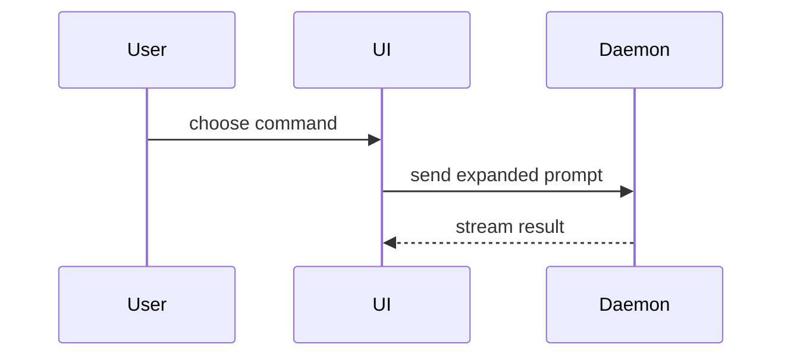

## 本機批次 PR 報告

`implement-spec` 交付時，在來源整合 worktree 建立 `pr/<YYYY-MM-DD>-<spec-slug>-<batch-id>.md`，使用下方 Summary、Evidence、Merge Danger 結構並以繁體中文填寫。同批更新同一份報告；檔名衝突時加入唯一識別，不覆寫其他批次。這是版控內的本機證據，不要求建立遠端 PR。

報告另須包含：

- 批次識別、關聯 spec／tickets 與 session note 的相對連結。
- 來源分支、worktree 路徑、目標分支 `dev`、比較基準 SHA，以及報告寫入前已驗證的成果 SHA。
- 本批實際範圍、計畫差異、必要依賴、剩餘 TODO、驗收限制與阻礙。
- 實際執行的指令、結果與證據位置，Standards／Spec review 結果；預計執行不算通過，沒有 before 證據時如實說明。
- 狀態（待合併／已合併／合併受阻）、合併 SHA、清理結果；未發生事項填「尚未執行」。不符合交付門檻時標記受阻及原因。

成果 SHA 不包含報告自己的提交；其後只含已核對的報告、票單及 session note 更新時可沿用成果驗證，程式或設定變更則須重驗並更新成果 SHA。合併工具另綁定使用者選擇時的實際來源 HEAD。

核對內容、相對連結與變更範圍，依 `AGENTS.md` 的文件提交規則詢問本批報告與其他收尾文件的提交意願。未獲同意時保留文件，明示「報告未提交」及路徑；保留來源 worktree，不將其列為可直接合併。已提交後回報報告路徑與提交 SHA，保留來源分支及 worktree，交由使用者另行呼叫 `merge-worktrees`。此步不詢問或執行合併 `dev`。

## PR 內容格式

Use this template for writing the PR body:

```markdown
## Summary

<diagram, diff-sketch, or tree>

## Evidence

- **Before:** <screenshot/output/failing test run>
  **After:** <screenshot/output/passing test run>

## Merge Danger

**Door:** <one-way or two-way>

<optional: description>

**Blast Radius:** <one-word description>

<optional: potential ramifications of merge>
```

## Sections

Skip all preambles and keep prose brief. Use the user's domain language from `GLOSSARY.md`.

### Summary

Pick the smallest view that makes the key point clear.

- Show logic or an algorithm as pseudocode:

```text
on(save)
  if content is unchanged
    return cached result
  write new content
  return fresh result
```

- Show runtime control flow as a call tree:

```text
submitForm
  createSession
    persistPrompt
    launchAgent
  navigateToSession
```

- Show UI structure as a component tree, including state and module boundaries that matter:

```text
<SessionPage> (apps/example/src/routes/session.tsx)
  useSessionEvents()
  <SessionToolbar>
    <RunSkillButton> (packages/ui)
```

- Show file responsibility or a broad refactor as a shallow file tree:

```text
src/
├── commands/       # parses user actions
├── sessions/       # owns session state
└── transport/      # sends API requests
```

- Show component interaction, control flow, or data flow with Mermaid:



- Use `diff` when the point is what changes and the surrounding shape already exists. Match the diff shape to the topic.

For a component change:

```diff
 <SessionPage>
   useSessionEvents()
   <SessionToolbar>
+    <RunSkillButton />
   <SessionTimeline>
+    <SkillResultCard />
```

For a file-layout change:

```diff
 src/
 ├── commands/
+│   └── show-me.ts       # expands the slash command
 ├── sessions/
-└── transport.ts
+└── transport/
+    ├── client.ts
+    └── stream.ts
```

For a call-tree or call-stack change:

```diff
 submitForm
   createSession
     persistPrompt
+    expandSkillMention
     launchAgent
-  navigateToSession
+  navigateToSession
+    subscribeToEvents
```

For a state or control-flow change:

```diff
 on(save)
-  write content
+  if content is unchanged
+    return cached result
+  write new content
+  invalidate cache
```

- Show the whole block when most of it is new, when omitted context would hide ownership or order, or when the user needs a copyable target shape:

```ts
function expandSkill(command: string): string {
  const skillName = command.slice(1);
  return `use the ${skillName} skill`;
}
```

#### Guidance

Place each visual next to the short text it supports. Keep only the calls, files, props, states, and boundaries needed to answer the user's current question or the options to resolve the current discussion point.

You may use one of these, you may use several, it is unlikely you will use all of them. Use your judgement and don't overwhelm the user.

### Evidence

Concrete evidence that the change works. Show a before and after.

Screenshots are S-tier - when the environment is set up for it and the change is visual.

Execution-based evidence is A-tier. Test results, console output. Show the exact test that now fails and passes, using pseudocode.

### Merge Danger

Describe whether it's a one-way or two-way door. You can walk back through two-way doors, but not one-way doors. A PR that is cheap to roll back is lower risk. Changes that involve destructive actions or hard-to-reverse decisions are one-way doors.

The blast radius is the potential impact or scope of the changes introduced by this PR. Consider all possibilities. Examples are layout shift, breakages for consumers, mobile responsiveness, etc.
